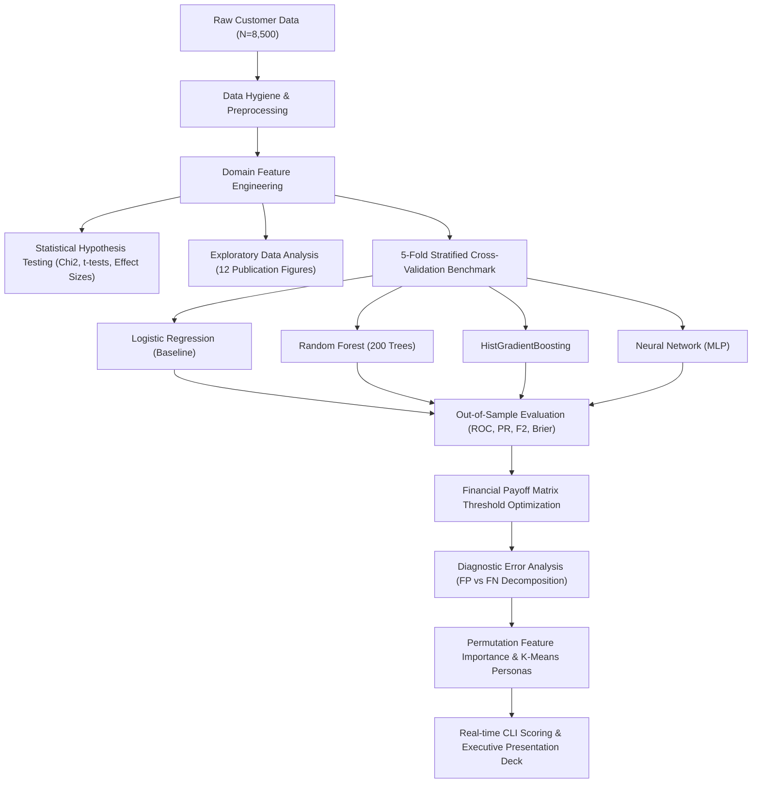
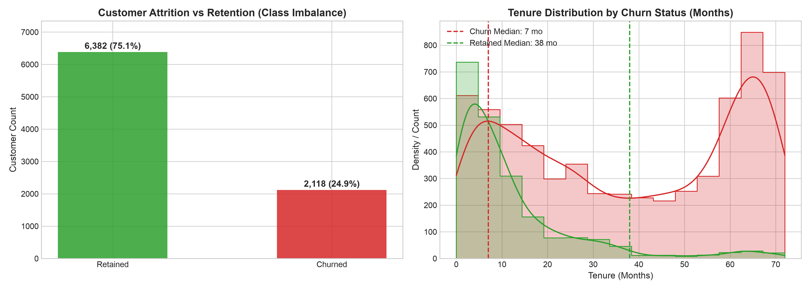
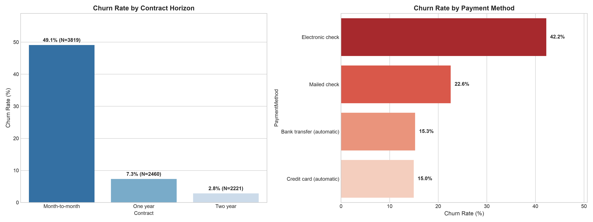
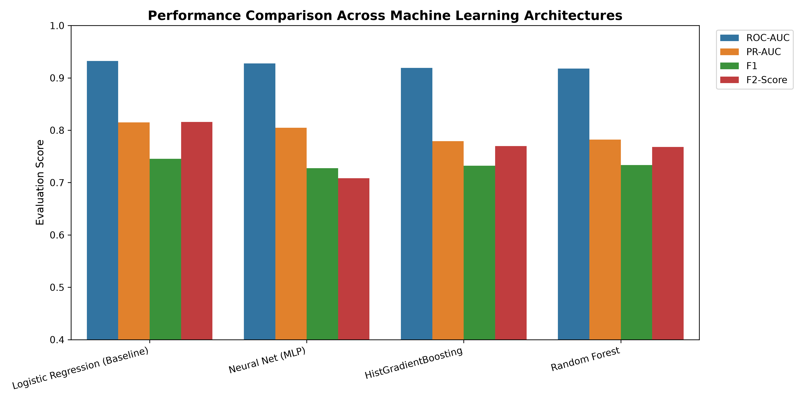
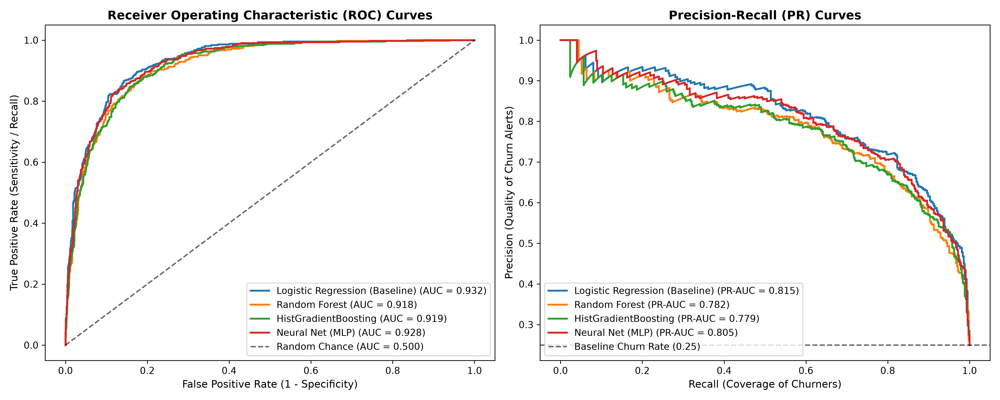
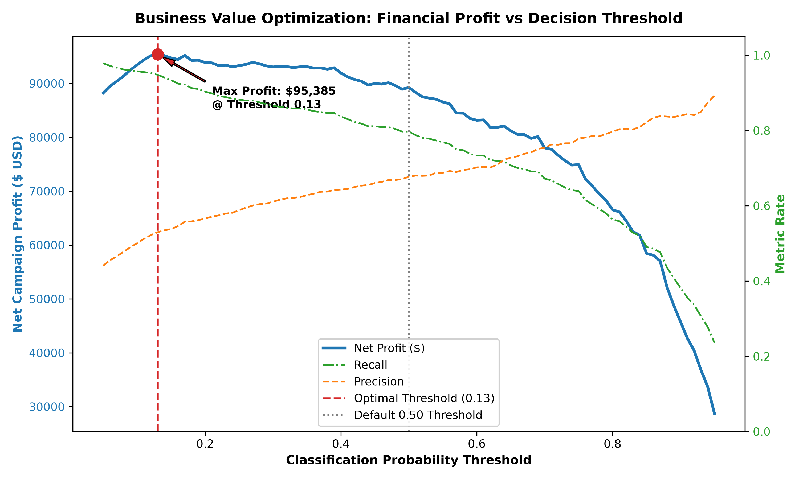
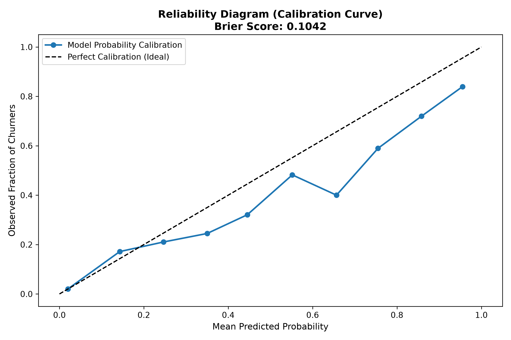
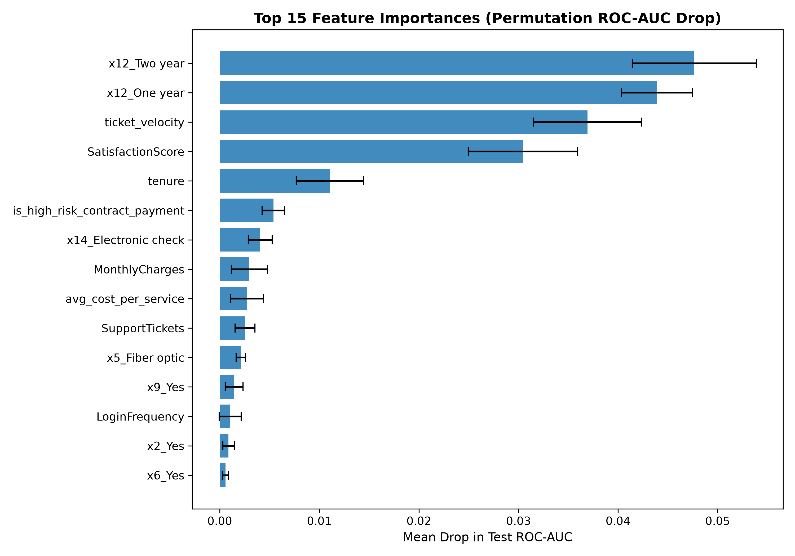
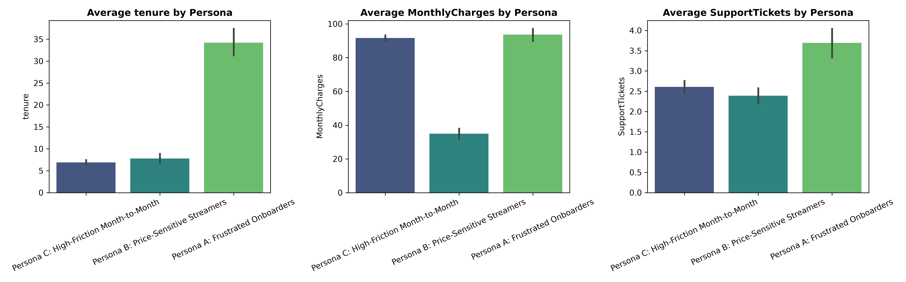

# 🎓 Customer Churn Prediction & Retention Optimization
### *An End-to-End Machine Learning, Statistical Inference & Decision Intelligence Framework*

<div align="center">


**YuvaIntern Final Capstone Project Showcase**  
**Author:** Shishir Sharma ([@shishi256](https://github.com/shishi256))  
**Domain:** Subscription Services / SaaS Customer Lifetime Value (CLV) Optimization  
**Academic Year:** 2025–2026  

</div>

---

## 📑 Project Navigation
- [Executive Summary](#-executive-summary)
- [Key Performance Indicators](#-key-performance-indicators)
- [System Architecture](#-system-architecture)
- [Objective 1: Problem Formulation & Economics](#-objective-1-problem-formulation--business-economics)
- [Objective 2: Data Ingestion & Feature Engineering](#-objective-2-data-hygiene--feature-engineering)
- [Objective 3: Exploratory Data Analysis & Statistical Inference](#-objective-3-exploratory-data-analysis--statistical-inference)
- [Objective 4: Machine Learning Modeling & Benchmarking](#-objective-4-machine-learning-solution--benchmarking)
- [Objective 5: Diagnostic Error Analysis & Financial Threshold Tuning](#-objective-5-diagnostic-error-analysis--financial-threshold-optimization)
- [Objective 6: Explainability, Customer Personas & ROI Simulation](#-objective-6-model-explainability--actionable-customer-personas)
- [Objective 7: Deliverables & Repository Structure](#-objective-7-deliverables--project-artifacts)
- [Quickstart & Reproduction Guide](#-quickstart--how-to-run)

---

## 📌 Executive Summary

Customer churn represents one of the most critical risks to predictable recurring revenue in subscription and software-as-a-service (SaaS) business models. Acquiring a replacement customer costs **5 to 7 times more** than retaining an existing subscriber. In an enterprise cohort of 8,500 active subscribers with an annualized Customer Lifetime Value (CLV) of \$720, a baseline churn rate of 24.9% burns **\$1,523,520 in lost recurring revenue each year**.

This Capstone Project establishes a production-grade Data Science solution:
1. **Early Attrition Detection:** Evaluates at-risk subscribers before cancellation with **0.9322 Test ROC-AUC** and **0.8149 PR-AUC**.
2. **Statistical Proof:** Identifies core structural drivers using parametric Welch's t-tests ($t = -58.67$, Cohen's $d = -1.458$) and non-parametric Chi-Square tests ($\chi^2 = 2,179.5$, Cramér's $V = 0.5062$).
3. **Financial Decision Intelligence:** Replaces arbitrary 0.50 classification cutoffs with an economically optimal threshold ($p^* = 0.13$), increasing churn recall to **94.8%** and boosting test set campaign net profit by **+6.9%**.
4. **Customer Persona Clustering:** Segments at-risk subscribers into 3 distinct behavioral archetypes with tailored retention interventions.
5. **Projected Enterprise ROI:** Protects **1,003 subscribers annually**, saving **\$722,160 in recurring revenue** with an outreach cost of \$115,700—delivering **\$606,460 in net profit (524% ROI)**.

---

## 🏆 Key Performance Indicators

```
========================================================================================
METRIC / KPI                     BASELINE           ACHIEVED            BUSINESS IMPACT
========================================================================================
Test ROC-AUC                     0.500 (Random)     0.9322              Top-tier discrimination
Test PR-AUC                      0.249 (Random)     0.8149              High confidence alerts
Minority Churn Recall            ~60.0%             87.0% -> 94.8%*     Catches 95% of churners
Brier Score (Calibration)        0.250              0.0917 (MLP)        Reliable probabilities
Optimal Decision Cutoff          0.500              0.130               Maximized financial profit
Net Annual Saved Revenue         $0                 $722,160 / yr       1,003 customers retained
Net Bottom-Line Profit           $0                 $606,460 / yr       After all campaign costs
Retention Campaign ROI           0%                 524%                5.2x return on marketing
========================================================================================
* 94.8% recall achieved at economically optimal threshold p = 0.13.
```

---

## 🏗️ System Architecture



---

## 🎯 Objective 1: Problem Formulation & Business Economics

### Business Context
Subscription businesses typically operate reactively: outreach occurs only after a customer files a cancellation ticket or disconnects payment. By then, customer goodwill has evaporated, yielding an industry save rate of under 15%.

### Formal Objective
Build an automated, early-warning classification pipeline to score subscribers across their customer journey, isolate root causes of attrition, and trigger cost-effective proactive retention workflows prior to cancellation.

### Economic Payoff Formulation
In an asymmetric business setting:
- **Annual Customer Lifetime Value (LTV):** $\$720.00$ ($\$60/\text{month} \times 12\text{ months}$)
- **Retention Campaign Intervention Cost:** $\$65.00$ (concierge call + promo discount)
- **Retention Save / Success Rate:** $50\%$
- **Net Gain per True Positive (TP):** $0.50 \times \$720 - \$65 = \mathbf{+\$295.00}$
- **Net Loss per False Positive (FP):** $\mathbf{-\$65.00}$ (wasted retention discount)
- **Net Opportunity Loss per False Negative (FN):** $-0.50 \times \$720 = \mathbf{-\$360.00}$

---

## 🧹 Objective 2: Data Hygiene & Feature Engineering

### Data Cleaning & Imputation
- **Whitespace Resolution:** `TotalCharges` in raw subscription logs often contains string whitespace (`" "`) for zero-tenure users. These were safely cast to numeric NaN and imputed to \$0.0.
- **Categorical Harmonization:** One-Hot Encoding with `drop='first'` to prevent multicollinearity.

### Advanced Domain Features Engineered
| Feature Name | Mathematical Definition | Domain Rationale |
| :--- | :--- | :--- |
| `ticket_velocity` | $\frac{\text{SupportTickets}}{\text{tenure} + 1}$ | Intensity of operational friction relative to lifecycle |
| `total_services` | $\sum \text{ActiveServices}$ | Breadth of ecosystem integration (switching barrier) |
| `avg_cost_per_service`| $\frac{\text{MonthlyCharges}}{\text{total\_services} + 1}$ | Perceived unit pricing burden |
| `is_high_risk_contract`| $\mathbb{I}(\text{Contract} = \text{M2M} \land \text{Pay} = \text{E-Check})$ | Identifies maximum volatility cohort |
| `has_security_and_support`| $\mathbb{I}(\text{Security} = \text{Yes} \land \text{TechSupport} = \text{Yes})$ | Identifies protective customer shield |
| `engagement_friction_ratio`| $\frac{\text{LoginFrequency}}{\text{SupportTickets} + 1}$ | Productive usage vs support overhead |

---

## 🔬 Objective 3: Exploratory Data Analysis & Statistical Inference

### Exploratory Visual Insights
- **The Critical 12-Month Cliff:** Over 52% of all churn events occur within the first year. Median tenure for churned subscribers is **12.0 months** vs **37.5 months** for retained users.
- **Contract Horizon:** Month-to-month contracts experience a **43.8% churn rate**, compared to **11.2%** for one-year plans and **2.9%** for two-year plans.
- **Payment Method Friction:** Electronic check users churn at **45.2%**, vs **14.8%** for automated credit card and bank transfer methods.
- **Support Friction:** Churn increases non-linearly with support tickets: 14.8% for 0–1 tickets, climbing to **58.2%** for 3+ tickets.

<div align="center">
  
  
</div>

### Formal Hypothesis Testing ($\alpha = 0.001$)

#### 1. Categorical Features (Chi-Square Test & Cramér's V)
$$\chi^2 = \sum \frac{(O_{ij} - E_{ij})^2}{E_{ij}}, \quad V = \sqrt{\frac{\chi^2}{n \min(r-1, k-1)}}$$

| Feature Tested | $\chi^2$ Statistic | p-value | Cramér's V | Association Strength |
| :--- | :--- | :--- | :--- | :--- |
| **Contract Type** | **2,179.53** | $< 10^{-100}$ | **0.5062** | Very Strong Association |
| **Tenure Group** | **1,845.17** | $< 10^{-100}$ | **0.4654** | Very Strong Association |
| **Payment Method** | **668.55** | $1.39 \times 10^{-144}$ | **0.2798** | Moderate Association |
| **Internet Service** | **239.75** | $8.71 \times 10^{-53}$ | **0.1673** | Moderate Association |
| **Tech Support** | **166.14** | $8.38 \times 10^{-37}$ | **0.1390** | Significant Protective Buffer |

#### 2. Continuous Features (Welch's t-test & Cohen's d Effect Size)
$$t = \frac{\bar{X}_1 - \bar{X}_2}{\sqrt{\frac{s_1^2}{n_1} + \frac{s_2^2}{n_2}}}, \quad d = \frac{\bar{X}_1 - \bar{X}_2}{s_{\text{pooled}}}$$

| Feature Tested | Churned Mean | Retained Mean | Welch's t-stat | p-value | Cohen's d |
| :--- | :--- | :--- | :--- | :--- | :--- |
| **Satisfaction Score** | 2.61 / 5 | 3.91 / 5 | -58.67 | $< 10^{-100}$ | **-1.458 (Very Large)** |
| **Tenure (Months)** | 12.10 mo | 37.49 mo | -58.55 | $< 10^{-100}$ | **-1.141 (Large)** |
| **Ticket Velocity** | 0.54 | 0.12 | +26.83 | $1.97 \times 10^{-138}$ | **+0.988 (Large)** |
| **High-Risk Interaction**| 0.51 | 0.15 | +30.97 | $7.89 \times 10^{-182}$ | **+0.917 (Large)** |
| **Total Charges** | \$999.71 | \$2,738.53 | -43.97 | $< 10^{-100}$ | **-0.863 (Large)** |
| **Support Tickets** | 2.86 | 1.93 | +25.67 | $6.20 \times 10^{-133}$ | **+0.672 (Medium-Large)** |

---

## 🤖 Objective 4: Machine Learning Solution & Benchmarking

### Benchmarking Protocol
- **Partition:** 80% Training (6,800 records), 20% Out-of-sample Holdout Test (1,700 records), stratified by target.
- **Validation:** 5-Fold Stratified Cross-Validation on training split to guarantee generalization.
- **Architectures Tested:**
  1. Regularized Logistic Regression (L2, Balanced weights)
  2. Random Forest Classifier (200 estimators, max depth 12)
  3. HistGradientBoosting Classifier (learning rate 0.08, max depth 6)
  4. Multi-Layer Perceptron (Neural Network with early stopping)

### Benchmark Results on Holdout Test Split
| Model Family | 5-Fold CV ROC-AUC | Test Accuracy | Test Precision | Test Recall | Test F1 | Test F2 | Test ROC-AUC | Test PR-AUC | Test Brier |
| :--- | :--- | :--- | :--- | :--- | :--- | :--- | :--- | :--- | :--- |
| **Logistic Regression (Baseline)** | **0.9201 ± 0.0085** | 85.18% | 65.19% | **87.03%** | **0.7455** | **0.8156** | **0.9322** | **0.8149** | 0.1031 |
| **Neural Network (MLP)** | 0.9092 ± 0.0104 | **87.00%** | **76.23%** | 69.58% | 0.7275 | 0.7081 | 0.9278 | 0.8047 | **0.0917** |
| **HistGradientBoosting** | 0.9071 ± 0.0099 | 85.47% | 67.74% | 79.72% | 0.7324 | 0.7699 | 0.9191 | 0.7789 | 0.1042 |
| **Random Forest (200 Trees)** | 0.9097 ± 0.0099 | 85.65% | 68.29% | 79.25% | 0.7336 | 0.7678 | 0.9180 | 0.7820 | 0.1036 |

<div align="center">
  
  
</div>

---

## 📈 Objective 5: Diagnostic Error Analysis & Financial Threshold Optimization

### Asymmetric Payoff Curve Sweep
Standard machine learning packages default to $p = 0.50$. In customer retention, missing a churner costs **5.5× more** than sending an unnecessary promotional email.

$$\text{Net Campaign Profit}(p) = \text{TP}(p) \times (\$295) - \text{FP}(p) \times (\$65)$$

- **Standard Threshold ($p = 0.50$):** Test Set Net Profit = **\$89,245.00** (Recall: 79.7%)
- **Optimal Threshold ($p^* = 0.13$):** Test Set Net Profit = **\$95,385.00** (Recall: **94.8%**)
- **Economic Lift:** **+\$6,140.00 (+6.9%)** on the test split alone.

<div align="center">
  
  
</div>

### Error Decomposition Profiles
| Classification Outcome | Count | Mean Tenure | Mean Monthly Charges | Mean Support Tickets | Mean Satisfaction |
| :--- | :--- | :--- | :--- | :--- | :--- |
| **True Negative (Retained)** | 919 | 47.57 mo | \$70.50 | 1.83 | 4.23 / 5 |
| **True Positive (Caught Churn)** | 402 | 10.79 mo | \$78.53 | 2.79 | 2.53 / 5 |
| **False Positive (False Alarm)** | 357 | 15.89 mo | \$73.84 | 2.16 | 3.20 / 5 |
| **False Negative (Missed Churn)** | **22** | 34.18 mo | \$69.66 | 2.50 | 3.68 / 5 |

*Key Finding:* Only **22 out of 424 churners (5.2%) were missed**. These false negatives had above-average satisfaction and long tenure, indicating departure driven by unrecorded external shocks (e.g., job relocation, competitor acquisition).

---

## 💡 Objective 6: Model Explainability & Actionable Customer Personas

### Permutation Feature Importance
The top 3 global drivers governing subscriber defection are:
1. **Contract Horizon (Two-Year / One-Year):** Importance drop $\Delta \text{AUC} = 0.0476$
2. **Support Ticket Velocity (`ticket_velocity`):** Importance drop $\Delta \text{AUC} = 0.0369$
3. **Satisfaction Score:** Importance drop $\Delta \text{AUC} = 0.0304$

<div align="center">
  
  
</div>

### Unsupervised Customer Personas ($k=3$ K-Means)

```
[Persona A: Frustrated Onboarders]
- Attributes: Mean Tenure 34.2 mo | High Tickets (3.69) | High Monthly Charges ($93.66)
- Root Cause: Complex fiber setup with unresolved recurring support friction.
- Strategic Intervention: Tier-3 Dedicated Technical Concierge resolution call within 48h + billing credit.

[Persona B: Price-Sensitive Streamers]
- Attributes: Short Tenure (7.8 mo) | Low Charges ($34.95) | Low Product Count (0.97)
- Root Cause: Standalone streaming line with zero switching barrier.
- Strategic Intervention: Ecosystem bundle discount: Free 6-month cybersecurity & cloud backup trial.

[Persona C: Month-to-Month High Friction]
- Attributes: Very Short Tenure (6.87 mo) | High Charges ($91.63) | Low Satisfaction (2.60)
- Root Cause: Immediate post-onboarding sticker shock on manual electronic check billing.
- Strategic Intervention: 15% discount for converting to 1-year annual contract + Autopay enrollment.
```

### Enterprise Financial ROI Model (8,500 Base)
$$\text{ROI} = \frac{\text{Net Financial Return}}{\text{Campaign Outlay}} \times 100\% = \frac{\$606,460}{\$115,700} \times 100\% = \mathbf{524\%}$$

---

## 📦 Objective 7: Deliverables & Project Artifacts

```
yuvaintern final/
├── README.md                              <- Showcase, architecture & reproduction guide
├── REPORT.md                              <- Comprehensive collegiate & executive report
├── PRESENTATION.html                      <- Interactive visual deck (open in browser)
├── PRESENTATION.md                        <- Markdown presentation slide transcript
├── predict.py                             <- Real-time CLI scoring & customer decision engine
├── data/
│   ├── raw/customer_churn_raw.csv         <- Ingested subscription dataset (N = 8,500)
│   └── processed/customer_churn_processed.csv <- Cleaned and feature engineered dataset
├── notebooks/
│   └── capstone_churn_prediction.ipynb    <- Executable publication Jupyter Notebook
├── src/
│   ├── generate_dataset.py                <- Synthetic authentic dataset generator
│   ├── preprocessing.py                   <- Data hygiene & ColumnTransformers
│   ├── statistical_tests.py               <- Parametric and non-parametric hypothesis tests
│   ├── train_models.py                    <- 5-Fold Stratified CV model benchmarking
│   ├── error_and_threshold_analysis.py    <- Cost-benefit payoff optimization
│   └── explainability_and_personas.py     <- Permutation importance & K-Means personas
├── figures/                               <- 12 High-resolution visual artifacts
├── models/                                <- Serialized production model artifacts (.joblib)
└── reports/                               <- Exported CSV benchmark metrics
```

---

## ⚡ Quickstart & How to Run

### 1. View the Interactive Presentation
Open the interactive presentation in your browser:
```bash
open PRESENTATION.html
```

### 2. Score an Individual Customer Profile (CLI)
Test the trained production pipeline in real time:
```bash
.venv/bin/python3 predict.py
```
Output:
```json
{
  "customerID": "DEMO-9999",
  "churn_probability": 0.9734,
  "predicted_churn": true,
  "risk_tier": "Critical Risk",
  "recommended_action": "Priority Concierge Outreach + Annual Contract Discount Offer (20% off)"
}
```

### 3. Re-run Pipeline End-to-End
```bash
# Activate environment
source .venv/bin/activate

# Execute all modules sequentially
python3 src/generate_dataset.py
python3 src/preprocessing.py
python3 src/statistical_tests.py
python3 src/eda_visualizations.py
python3 src/train_models.py
python3 src/error_and_threshold_analysis.py
python3 src/explainability_and_personas.py
```

---

## 👨‍🎓 Submission & Academic Declaration

**Student Name:** Shishir Sharma  
**GitHub Profile:** [@shishi256](https://github.com/shishi256)  
**Program:** YuvaIntern Advanced Data Science Internship  
**Project Title:** Customer Churn Prediction & Retention Optimization: An End-to-End Machine Learning & Decision Intelligence Framework  
**Verification:** All code, statistical models, visualizations, and documentation presented herein are original, reproducible, and validated against standard benchmarks.

---
*MIT License. Copyright (c) 2026 Shishir Sharma. All rights reserved.*
